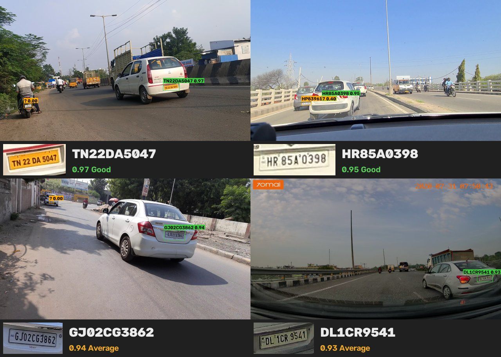
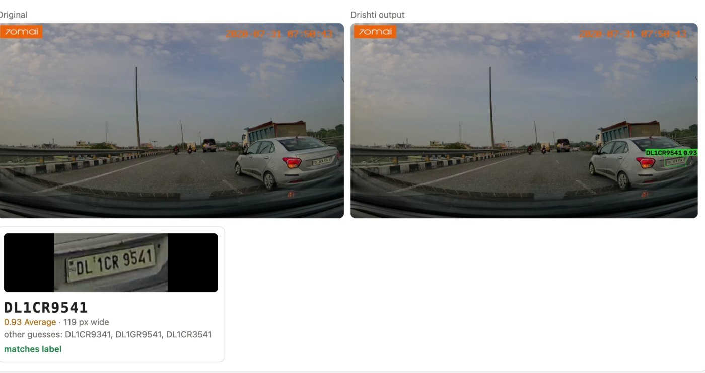

# Drishti

[](https://github.com/Tejascodz/drishti/actions/workflows/ci.yml)
[](LICENSE)


Number plate recognition for Indian roads. Drishti reads plates in photos, video files and
RTSP streams on an ordinary CPU, tracks each vehicle across frames, and reports one fused
reading per vehicle with a calibratable confidence. A plate it cannot read is reported as
unreadable rather than guessed.



<sub>Real road photos (demo images from [sanchit2843/Indian_LPR](https://github.com/sanchit2843/Indian_LPR),
fetched by `scripts/fetch_samples.sh`), read with the default models: Drishti's trained YOLO26 plate detector and the public OCR. All four
reads match their labels. Regenerate: `python scripts/make_readme_images.py samples --count 4`.</sub>

## Contents

[Results](#results) · [How it works](#how-it-works) · [Quick start](#quick-start) ·
[Your own models](#your-own-models) · [Command line](#command-line) · [Python](#python) ·
[REST API](#rest-api) · [Toll and gantry cameras](#toll-and-gantry-cameras) ·
[Configuration](#configuration) · [Training](#training) · [Project layout](#project-layout) ·
[Development](#development) · [Security and privacy](#security-and-privacy) ·
[Limitations](#limitations) · [Licence](#licence)

## Results

| Test | Result |
|---|---|
| Plate detection, 2,082 validation photos (37 Indian + 2,045 Roboflow) | trained YOLO26-s 960: recall **96.1%**, precision **97.5%**, small-plate recall **86.0%** (public yolo-v9-s-608: 93.6% / 96.4% / 79.3%) |
| Plate detection, Roboflow v13 test split (1,020 photos) | public yolo-v9-s-608: recall 94.8%, precision 98.0% |
| 4 labelled Indian road photos (GJ, TN, DL, HR) | all 4 plates read by every detector × OCR combination; public OCR confidence 0.95, first fine-tuned OCR 0.65 |
| Same photos shrunk to 70 / 55 / 45 px wide plates, JPEG q60–30 (48 cases) | 4 / 16 at 70 px, none below; reading, not detection, is the limit (see [`docs/RESULTS.md`](docs/RESULTS.md)) |
| 600 heavily degraded synthetic Indian plates, same OCR | exact match 37.2% with free decoding → **50.2%** with the Indian format grammar |
| Synthetic approaching-vehicle clips, 60 frames each | 2 of 3 plates correct at track level (0.85, 0.99) from 22% and 70% correct single frames; the third is one character short and flagged low-confidence (0.34) |
| Latency, 2-core CPU, 1080p | detector ≈ 150 ms, OCR ≈ 30 ms per batch of crop views, 300–650 ms per photo |

To check reads by eye, `scripts/review_reads.py` builds a page with each original photo next to
Drishti's output and every plate enlarged with its text, confidence, plate width, other guesses and,
given a labels file, whether it matches:



<sub>`python scripts/review_reads.py samples --labels samples/labels.csv --out review` on the DL dashcam sample.</sub>

Method, data and every intermediate experiment: [`docs/RESULTS.md`](docs/RESULTS.md).
The labelled sets are small; treat the reading results as smoke tests until you run
`drishti eval` on footage from your own camera.

## How it works

```
frame ─► plate detector ─► crop views ─► slot OCR ─► Indian format grammar ─┐
  │      YOLO26 (ONNX)     3-4 paddings,  CCT, per-slot  state codes, I/O rule, │
  │                         deskew,        probabilities  BH / VA / army / ...  ▼
  │                         two-line,                                 fused read per photo
  │                         4x super-res                      unreadable ─► rescue views
  └─► vehicle detector ─► tracker ─► per-track evidence ─► multi-frame fusion ─► event
      RF-DETR (optional)  ByteTrack,    best frames by       logit averaging +    plate, confidence,
                          buffered IoU  image quality        aligned frame stack  alternatives, vehicle
                                                     low confidence ─► local VLM check (optional)
```

| Stage | What it does | Code |
|---|---|---|
| Plate detection | YOLOv9 end-to-end, YOLO26 end-to-end (detect or 4-corner pose) and raw Ultralytics heads, detected from the ONNX output shape; large frames are tiled for distant plates | `drishti/detect/plate.py` |
| Crop views | Each plate is cropped at several paddings, rectified from detector corners or deskewed, and stacked plates are also stitched into one line | `drishti/geometry.py` |
| OCR | fast-plate-ocr compatible slot OCR; the full slot × character probability matrix is kept, not only the arg-max | `drishti/ocr/slot_ocr.py` |
| Format grammar | Exact search for the most probable *valid* registration mark: real state codes (incl. TS→TG, OR→OD, UA→UK), series letters without I/O, Delhi short RTO codes, Bharat, vintage, temporary, armed-forces and diplomatic layouts. `GJO2CG3862` → `GJ02CG3862` | `drishti/formats/` |
| Fusion | Views and frames that agree on layout are combined by weighted log-probability averaging, then decoded again | `drishti/fusion.py` |
| Super-resolution | Small or unsure plates are also read from a Real-ESRGAN 4x restored crop; the restored read is an extra opinion fused with the others, never a replacement | `drishti/pipeline.py` |
| Small plates | Plates under 90 px wide are read from tight crops only, so the few pixels per character are not shrunk further | `drishti/pipeline.py` |
| Rescue | Unreadable or low-confidence plates are re-read through deblocked (upscale + non-local-means), zoomed, contrast-enhanced, gamma-corrected and best-channel copies; a rescued read is capped below the auto-charge threshold | `drishti/imaging.py` |
| Video | ByteTrack-style tracking with buffered IoU, frame selection by image quality, ECC-registered stacking of the best crops, one event per vehicle with direction, type and colour | `drishti/track.py`, `drishti/pipeline.py` |
| Confidence | String probability × cross-view agreement, or a logistic model fitted on your labelled data (`drishti calibrate`) | `drishti/fusion.py`, `drishti/evaluate.py` |
| VLM check | Optional: a local vision-language model (Ollama) re-reads low-confidence plates; its answer counts only if it is a valid plate and one of the OCR's candidates or one edit away. Plates the OCR cannot read at all are read by the VLM alone, accepted only as a valid plate and always sent to manual review. The VLM sees only the characters' band, with light-on-dark plates (green EV, black rental) turned into dark-on-light negatives | `drishti/ocr/vlm.py`, `drishti/geometry.py` |

Design background and sources: [`docs/RESEARCH.md`](docs/RESEARCH.md).

## Quick start

Python 3.10 or newer.

```bash
git clone https://github.com/Tejascodz/drishti.git && cd drishti
python -m venv .venv && source .venv/bin/activate
pip install -e ".[server,track]"
drishti models pull                     # detector, OCR, super-resolution, vehicle model: ~170 MB, checksum-verified
bash scripts/fetch_samples.sh samples   # 4 labelled Indian road photos

drishti image samples --save-vis out    # prints each plate, writes annotated copies to out/
drishti eval samples/labels.csv         # recognition rate, precision, character accuracy
```

The default plate detector is Drishti's YOLO26-s model trained for Indian roads, downloaded
from this repository's [releases](https://github.com/Tejascodz/drishti/releases); the OCR is the
public fast-plate-ocr CCT-S v2 model; small or unsure plates also get a Real-ESRGAN super-resolved
crop as an extra opinion (`models.sr_model`, `null` to disable).

NVIDIA GPUs: `pip install -e ".[gpu]"` and `--config configs/gpu-server.yaml` (TensorRT,
FP16). Apple silicon: `--config configs/apple-silicon.yaml` runs the detector on CoreML; the
OCR always runs on CPU, where it is fast and CoreML can stall.

## Your own models

The defaults (trained detector, public OCR) are the best combination measured so far. To use
your own models, copy the ONNX files into `models/` (git-ignored) and point a copy of the
template `models/drishti.yaml` at them:

```bash
python scripts/check_models.py --detector models/my_detector.onnx \
    --ocr models/ocr_in/best.onnx --ocr-config models/ocr_in/best_plate_config.yaml
drishti --config models/drishti.yaml image photos/ --save-vis out
```

| Script | Purpose |
|---|---|
| `scripts/check_models.py` | Validates a detector + OCR pair: ONNX loads, input/output shapes, OCR output vs its plate config, comparison with the public OCR it was fine-tuned from, then the full pipeline on labelled photos |
| `scripts/review_reads.py` | HTML page for checking reads by eye: every photo annotated, every plate crop enlarged with its text, confidence and alternatives |
| `scripts/compare_setups.py` | Every public/own detector × OCR combination, plus your models with the local VLM, on one labelled CSV, as a table and per-photo reads |
| `scripts/benchmark_degraded.py` | Accuracy on shrunk, JPEG-compressed, blurred copies of labelled photos (small and messaging-app plates); `--vlm-model` adds the local VLM |
| `scripts/make_readme_images.py` | The results image above, from photos you may publish |

```bash
python scripts/review_reads.py photos/ --config models/drishti.yaml --out review && open review/index.html
python scripts/compare_setups.py samples/labels.csv --vlm-model qwen3-vl:2b
```

Labelled CSVs are `image_path,plate_text`, paths relative to the CSV, several plates in one
photo separated by `|`.

## Command line

| Command | Purpose |
|---|---|
| `drishti image PATH... [--save-vis DIR] [--json] [--debug DIR]` | Read plates in photos or folders; `--debug` saves every crop the OCR reads and prints its read of each |
| `drishti video SOURCE [--save-vis out.mp4] [--out events.jsonl] [--store]` | File, RTSP/HTTP stream or webcam index; one event per vehicle |
| `drishti toll PHOTO` | Toll decision: automatic above the confidence threshold, otherwise manual review |
| `drishti zones SOURCE --out zones.jpg` | Frame with a 0–1 grid for choosing a lane polygon and trigger line |
| `drishti eval labels.csv [--report eval.json]` | Recognition rate, precision, character accuracy, confidence gap, latency |
| `drishti calibrate eval.json` | Fit the confidence model on an evaluation report |
| `drishti label PATH... --out DIR` | Label plate text with the OCR and a local VLM; disagreements go to an offline review page |
| `drishti watch add\|remove\|list PLATE` | Watchlist with confusion-aware matching (`O`≈`0`, `1`≈`I`) |
| `drishti events [--plate 'KA05*']` | Query stored events |
| `drishti serve [--host --port]` | REST API |
| `drishti bench` | Detector, OCR and full-photo latency on this machine |
| `drishti vlm-check` | Is the local VLM reachable and installed |
| `drishti models pull\|list` | Download or list the models |

Common options: `--config FILE` (repeatable, later files win), `--region india|brazil|generic|pack.yaml`,
`--providers auto|cpu|cuda|tensorrt|coreml|openvino`, `--no-vehicles`, `--vlm`.

## Python

```python
from drishti import Drishti, load_config

eng = Drishti(load_config("models/drishti.yaml"))

for plate in eng.recognize("photo.jpg"):
    print(plate.read.text, plate.read.confidence, plate.read.level, plate.read.alternatives[:3])

events = eng.process_video("clip.mp4", on_event=lambda e: print(e.text, e.confidence, e.direction))
```

## REST API

```bash
DRISHTI_API_KEY=change-me drishti serve --host 0.0.0.0 --port 8000
curl -H "X-API-Key: change-me" -F file=@photo.jpg http://localhost:8000/v1/recognize
```

| Method | Path | Description |
|---|---|---|
| POST | `/v1/recognize` | Photo → plates (`?annotate=true` adds an annotated JPEG) |
| POST | `/v1/recognize/video` | Video → one event per vehicle (`?persist=true` stores them) |
| POST | `/v1/toll` | Photo → automatic or manual-review decision |
| GET | `/v1/events` | `?plate=KA05*&camera=&since=&limit=` |
| GET, POST, DELETE | `/v1/watchlist` | Manage the watchlist |
| GET | `/healthz`, `/metrics` | Models and providers; Prometheus metrics |

With `DRISHTI_API_KEY` set, every `/v1` endpoint requires `X-API-Key: <key>` or
`Authorization: Bearer <key>`; `drishti serve` warns when it listens beyond localhost without one.

Docker (CPU, non-root, models baked in, data in a volume):

```bash
docker build -t drishti .
docker run -p 8000:8000 -e DRISHTI_API_KEY=change-me -v drishti-data:/data drishti
```

## Toll and gantry cameras

A camera above a lane, looking down at the front plates of approaching vehicles:

```bash
drishti zones rtsp://cam/lane3 --out zones.jpg       # pick the lane polygon and trigger line off the grid
drishti --config models/drishti.yaml --config configs/toll-booth.yaml video rtsp://cam/lane3 --camera lane-3 --store
```

* **Lane zone (`roi`).** Plates outside the polygon (next lane, queue, roadside) are ignored.
* **Trigger line.** When a plate crosses it in `trigger_direction`, the event is emitted at
  once from every frame seen so far: one decision per vehicle at the barrier. If later frames
  change the read, a correction event (`corrects: <event_id>`) follows.
* **Barrier-free (MLFF) gantries.** `configs/highway-mlff.yaml`: few frames per plate, wide
  tracking buffers, plates that never reach the line are still reported.

How Drishti maps to the Indian MLFF ANPR camera specification (IHMCL):

| Requirement | Drishti |
|---|---|
| Confidence level on every read | `confidence_level` Good / Average / Poor on every read and event |
| Camera-only transaction above 95% confidence | `drishti toll`, `engine.toll()`: automatic only above `tolling.auto_min` (0.95) |
| Bad pixel correction | Per-frame hot/dead pixel and demosaic-cluster correction, plus a learned per-camera stuck-pixel map (`imaging.bad_pixel`) |
| Edge enhancement | Optional unsharp-masked OCR view, kept only when it agrees with the others (`imaging.edge_enhance`) |
| Plate pixel density (100–150 px wide) | `plate_width_px` on every event; narrower plates are flagged |
| Lane reconfiguration in software | `zones`: polygon, trigger line, direction |
| Overlapping cameras, no duplicates | `dedupe`: the same plate from another camera within a window is marked `duplicate_of` |
| Maintenance | Camera health alerts: dark, overexposed, soft (dirty window), blocked, frozen, moved, sensor defects |
| IR night vision | Synthetic training data includes infrared night frames |

Thresholds mean something only after calibration on labelled frames from the lane camera:
`drishti eval labels.csv --report eval.json`, then `drishti calibrate eval.json`.

## Configuration

Defaults live in [`drishti/default.yaml`](drishti/default.yaml), each key documented. Override
with `--config FILE` (repeatable; later files win) or environment variables
(`DRISHTI__VIDEO__MAX_AGE=45`).

| Preset | For |
|---|---|
| `models/drishti.yaml` | Template for your own detector and OCR files |
| `configs/toll-booth.yaml` | One lane, overhead camera, lane polygon and trigger line |
| `configs/highway-mlff.yaml` | Barrier-free gantries, fast vehicles |
| `configs/edge-cpu.yaml` | Raspberry Pi 5, NUC, older laptops: small models, two views |
| `configs/gpu-server.yaml` | NVIDIA, TensorRT FP16 |
| `configs/apple-silicon.yaml` | CoreML detector |

Presets that choose models (`edge-cpu`, `gpu-server`, `apple-silicon`) go before
`models/drishti.yaml` when combined, so your models win.

Formats are YAML region packs in `drishti/formats/packs/` (`india`, `brazil`); a country is a
few lines of classes, sets and patterns.

## Training

Labelling runs locally with a vision model in Ollama; training runs on Kaggle's free T4 GPUs.

1. `drishti label photos/ --out data/ocr_real` reads every plate with the OCR and the VLM
   independently. Agreements are accepted; the rest are fixed in an offline review page.
2. Run `training/kaggle/drishti_detector_kaggle.ipynb` and `drishti_ocr_kaggle.ipynb`.
   The OCR notebook (v3) fine-tunes the public OCR on 120,000 synthetic plates plus your real
   crops, checks GPU, internet and inputs in its first minutes, and scores the public and the
   new model on real, hard synthetic and green EV plates. Both notebooks report the current
   and the new model on the same validation set.
3. Check and compare the exported models (`scripts/check_models.py`,
   `scripts/compare_setups.py`) before pointing `models/drishti.yaml` at them.

Full guide: [`docs/TRAINING.md`](docs/TRAINING.md). Synthetic Indian plate generator (HSRP
layouts; white, yellow, green EV, black rental, army and diplomatic colour schemes; dotted and
hyphenated separators; emblems; thin aftermarket strips; two-line plates; overhead geometry;
infrared): `training/synth/render_plates.py`.

## Project layout

```
drishti/                 library
  detect/                plate and vehicle detectors
  ocr/                   slot OCR, VLM verifier
  formats/               format grammar, region packs, confusable glyphs
  pipeline.py            image and video engine
  fusion.py track.py     evidence fusion, tracking
  imaging.py geometry.py image clean-up, crops, rectification, two-line stitching
  server/ cli.py         REST API, command line
configs/                 deployment presets
models/                  your config (ONNX weights are git-ignored)
scripts/                 model checks, review page, comparisons, samples, README images
training/                synthetic plates, OCR and detector recipes, Kaggle notebooks
docs/                    RESULTS, TRAINING, RESEARCH
tests/                   pytest suite
```

## Development

```bash
pip install -e ".[server,track,dev]"
ruff check drishti scripts tests training
pytest
```

CI runs lint and tests on Python 3.10 and 3.12 for every push and pull request. See
[`CONTRIBUTING.md`](CONTRIBUTING.md) and [`CHANGELOG.md`](CHANGELOG.md).

## Security and privacy

* Set `DRISHTI_API_KEY` whenever the API is reachable from a network; the Docker image runs
  as a non-root user.
* Every model the hub downloads is verified against a pinned SHA-256; a mismatching file is
  discarded.
* Plate numbers are personal data in many jurisdictions. `privacy.hash_plates`,
  `privacy.blur_non_matches` and `privacy.retention_days` cover storage; datasets, camera
  frames, databases and weights are kept out of the repository.
* Report vulnerabilities privately as described in [`SECURITY.md`](SECURITY.md).

Use ANPR only where you are permitted to.

## Limitations

* The bundled OCR is the public global model; the first Indian fine-tuning run is not yet
  better (see [Results](#results)).
* Green EV plates with dotted separators or emblems (e.g. `KA·53HS·3074`) are not read by
  the public OCR; the v3 fine-tune trains on these styles.
* Plates below about 60 px wide are at the information limit: super-resolution and rescue
  views help a little, but cannot recover characters that are not in the pixels.
* Small two-line plates (two-wheelers at a distance) are the weakest case.
* The detectors have no corner head, so perspective is corrected by deskewing; a YOLO26-pose
  corner model can be trained with `training/detector/`.
* Confidence is uncalibrated until `drishti calibrate` is run on labelled data from your camera.

## Licence

Drishti is released under the [MIT licence](LICENSE).

Models downloaded at runtime keep their own licences. The default plate detector
(`drishti-yolo26s-in-960`, from this repository's releases) was trained with Ultralytics YOLO26
and is AGPL-3.0; a closed product needs an Ultralytics enterprise licence, or can switch to the
MIT-licensed `yolo-v9-s-608-license-plate-end2end` with `models.plate_detector`. fast-plate-ocr
OCR models and open-image-models detectors are MIT, RF-DETR is Apache-2.0, and the super-resolution
model (Real-ESRGAN realesr-general-x4v3, converted by `training/sr/export_realesrgan.py`) is BSD-3-Clause,
© Xintao Wang. Datasets: Indian licence plates (Kaggle, CC0), Roboflow
License Plate Recognition v13 (CC BY 4.0).
